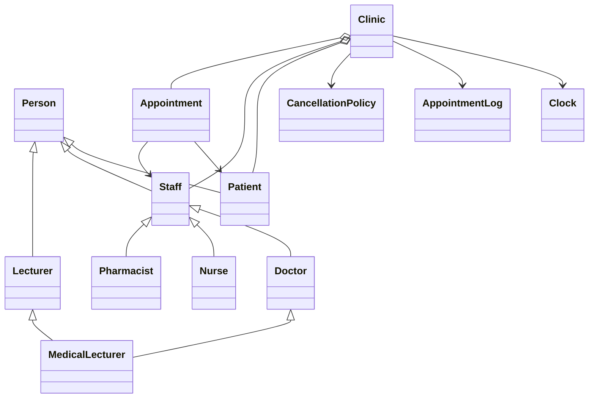

# Clinic Appointment System

A small Python terminal program for managing clinic patients, staff, and
appointments. It uses only Python's standard library.

**Registration number:** 2420089

**Pair members:** Marlvin A. Munyanyi and Takudzwa Pablo Magawagawa

**Python version:** 3.14

The registration number gives `2420089 mod 4 = 1`, so this project uses the
**emergency booking** option from the assignment.

## Project files

```text
ClinicAppointmentSystem/
├── main.py                 # Menu and demonstrations
├── models/                 # People and appointments
├── policies/               # Cancellation rules
├── services/               # Clinic, clock, and log
├── tests/                  # Automated tests
└── README.md
```

## Start the program

Open PowerShell in the project folder and run:

```powershell
python main.py
```

Choose a number from the menu. Option 15 runs the full sample demonstration;
option 16 exits.

To run the tests:

```powershell
python -m unittest discover -s tests -v
```

## Class diagram



## How the main parts work

- **Person** is the shared base for people. It checks that names are not blank
  and IDs are positive integers.
- **Patient** can be marked as an emergency patient.
- **Staff** is the shared base for clinic workers. Doctors, nurses, and
  pharmacists each supply their own role and fee.
- **Appointment** connects one patient with one staff member at one start hour.
  Appointments last one hour.
- **Clinic** registers people and applies the booking rules.
- **Clock** provides the current clinic hour. The program does not read the
  computer's clock.
- **AppointmentLog** records each clinic action, including failed actions.
- **CancellationPolicy** checks when an appointment can be cancelled.
- **Lecturer** has a module name. **MedicalLecturer** is both a doctor and a
  lecturer.

The project demonstrates four common object-oriented ideas:

- **Encapsulation:** fields are kept inside objects; the clinic gives out
  read-only views of its lists.
- **Abstraction:** `Person` and `Staff` define behavior their subclasses must
  provide.
- **Inheritance:** patients and staff are people; doctors, nurses, and
  pharmacists are staff.
- **Polymorphism:** one loop can print every staff member's role and fee by
  calling the same methods. It does not need a different loop for each role.

For registration number `P = 2420089`, the fees are:

| Staff member | Calculation | Fee |
|---|---|---:|
| Doctor | `40 + 5 * (P % 5)` | 60 |
| Nurse | `10 + (P % 3)` | 11 |
| Pharmacist | `5` | 5 |

## Appointment rules

An appointment starts as `PENDING`. It may be confirmed or cancelled. A
confirmed appointment may also be cancelled, but only with at least two
hours' notice. Once cancelled, it cannot be restored. No appointment can be
cancelled once it has started.

The clinic prevents a patient or staff member from having two active
(non-cancelled) appointments at the same hour. IDs must be unique across all
registered patients and staff.

`Clinic.book_appointment()` checks the existing appointments before booking.
It ignores cancelled appointments and rejects the booking if the same patient
or the same staff member already has a non-cancelled appointment at that hour.
For emergencies, it first checks every conflict; if even one is confirmed, it
rejects the request before cancelling any pending appointments.

The clinic hour is a whole number from 0 to 168. The `Clock` starts at hour 10
in the menu and can be advanced in the demonstration. Passing a `Clock` into
the clinic makes time predictable in tests; tests do not need to wait for the
real time to change.

## Emergency bookings

An emergency patient can replace a conflicting `PENDING` appointment. The
clinic first checks all appointments that conflict. If any is already
`CONFIRMED`, the emergency booking is rejected and none of the other bookings
are changed. Otherwise, each conflicting pending appointment is cancelled
with the reason `"bumped"`, and the new emergency appointment is created as
`PENDING`. A regular patient cannot bump another booking.

## Logging

Each clinic action opens the log, records success or failure, and tries to
close the log even if the action fails. Errors are still reported to the
caller; they are not silently ignored.

For example, the deliberate failed cancellation in option 15 prints:

```text
[log] opened
FAILED cancel #1: too late: confirmed appointments need 2 hours' notice
[log] closed
```

If the output stream itself fails, the program cannot guarantee the log entry
was written. It reports the write or close error instead of pretending the
entry was saved.

## Multiple inheritance

`MedicalLecturer` inherits from both `Doctor` and `Lecturer`. Python's method
resolution order (MRO) is the order Python follows when looking for methods.
Both parent classes use `super()`, so they share one `Person` base and its
constructor runs once. Option 12 prints the MRO and the constructor count.

`MedicalLecturer.fee()` uses the doctor fee because the lecturer role does not
add a separate clinical fee. In Java, a class cannot extend two classes, so
`Lecturer` would be an interface; `MedicalLecturer` would extend `Doctor` and
implement `Lecturer`.

## Five-minute demonstration

Choose option 15 to see sample patients and staff registered, staff fees
printed, appointments booked and cancelled, and a failed cancellation logged.
It also demonstrates an emergency bump, rejection when a confirmed booking
conflicts, the controlled clock, and multiple inheritance. The sample uses
fixed names and hours so the result is repeatable.

## Design decisions

### D1. Where is the two-hour rule?

It is in `CancellationPolicy`, which `Appointment` calls. Putting it only in
the clinic could let someone cancel an appointment another way without the
check. Keeping it in a separate class also makes the rule easier to change
without mixing it into appointment status handling.

### D2. Why use a Clock?

Tests can set a known hour and advance it. Using the computer's time directly
would make timing tests unpredictable and harder to repeat.

### D3. What changed for Pharmacist?

The pharmacist class provides its role and fee. The shared display loop and
clinic do not need pharmacist-specific code. Nothing else leaked into the
clinic or the loop: polymorphism lets each staff class supply its own role
and fee through the same methods.

### D4. What fee does MedicalLecturer use?

It uses the doctor fee. Python's MRO and cooperative `super()` calls make the
shared `Person` constructor run once. Calling both parent constructors
directly could initialize the same person twice.

### D5. What if logging fails?

The error is allowed to reach the caller. The program only adds a line to the
log history after writing succeeds, and it tries to write the closing line.
If the output device is unavailable, the program cannot promise that a line
reached it.

### D6. Why can emergencies bump pending appointments only?

A pending appointment is not yet confirmed. A confirmed appointment is a
commitment, so the clinic protects it and rejects the emergency booking.

## Note

Records are kept in memory and are cleared when the program exits. The
emergency booking twist is implemented; the other twist choices are not part
of this project.
